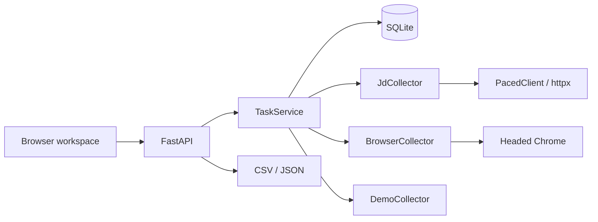
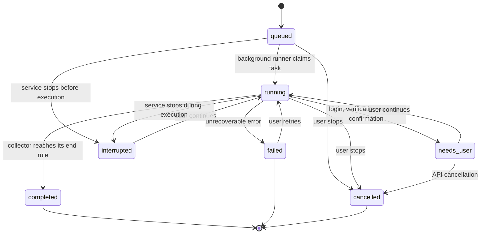

# Review Sampler Architecture

English · <a href="architecture.zh-CN.md"><ins>简体中文</ins></a>

[User guide](../product/user-guide.en.md) · [Platform policy](../platform-policy.md)

This document describes the version 0.1.0 implementation. It records what the repository actually does and does not present planned capabilities as available features.

## 1. Deployment shape

Review Sampler is a local, single-process Python application:

- FastAPI serves the API and static workspace.
- Uvicorn binds only to `127.0.0.1:8765`.
- SQLite stores tasks and reviews at `runtime/review-sampler.sqlite3` by default.
- Collection jobs run as threads inside the application process. There is no Redis, message queue, or separate worker.
- Browser assistance uses Playwright with a persistent Chrome profile.

Default data paths are relative to the directory where the process starts. `REVIEW_SAMPLER_DB` changes the database path. Browser profiles remain under `runtime/browser-state/`.



The startup entry point is [`review_sampler.main:run`](../../src/review_sampler/main.py). The repository-level [`main.py`](../../main.py) is only a compatibility launcher for the old direct-script entry point.

## 2. Code layers

| Layer | Location | Responsibility |
| --- | --- | --- |
| Page and client logic | [`static/`](../../src/review_sampler/static/) | Create tasks, poll state, filter reviews, and start downloads |
| HTTP API | [`app.py`](../../src/review_sampler/app.py) | Validate requests, route task operations, query reviews, and export |
| Task service | [`service.py`](../../src/review_sampler/service.py) | State transitions, thread scheduling, pause/resume, and error mapping |
| Storage | [`store.py`](../../src/review_sampler/store.py) | SQLite schema, transactions, deduplication, filtering, and restart recovery |
| Collectors | [`collectors/`](../../src/review_sampler/collectors/) | JD HTTP, browser assistance, and demo data |
| Input parsing | [`platforms.py`](../../src/review_sampler/platforms.py) | Platform, product ID, URL, and source mapping |
| Normalization | [`normalize.py`](../../src/review_sampler/normalize.py) | JSON aliases, ratings, DOM parsing, and challenge detection |
| Network access | [`net.py`](../../src/review_sampler/net.py) | Pacing, timeouts, bounded retries, and error classification |

Collectors handle platform access and response conversion. Task state, persistence, and export stay in the service layer, so a new adapter does not need a new task schema.

## 3. Startup and request flow

`build_default_app()` creates `Store`, `TaskService`, and the three collectors, then passes them to `create_app()`. During startup, `Store.recover_interrupted()` changes leftover `queued` and `running` tasks to `interrupted`.

Creating a task follows this path:

1. The client submits a platform, product input, limit, review direction, and browser consent state.
2. The API parses the product URL or bare ID and checks that it matches the selected platform.
3. Non-JD platforms require browser consent. JD browser fallback is available only when the task was created with consent.
4. `Store.create_task()` writes a `queued` task.
5. `TaskService.submit()` starts a background thread.
6. The execution thread marks the task `running` and calls the selected collector.
7. The collector calls `runtime.emit()` to save a batch and update its cursor.
8. The service marks the task `completed` after collection returns, or uses the appropriate state for human input and failures.

Task creation returns HTTP `202`. The client polls task and review data instead of keeping the creation request open for the whole collection run.

## 4. Task state machine

The fixed state set is defined in [`store.py`](../../src/review_sampler/store.py):

```text
queued, running, needs_user, interrupted, completed, failed, cancelled
```



`needs_user` and `failed` are different outcomes:

- `needs_user` normally keeps the browser collector thread alive. A `continue` request wakes the thread after the user handles the page.
- `failed` has no active thread. Retrying creates a new runner, and the collector starts from the stored task cursor.
- `interrupted` is produced by startup recovery. Continuing it also creates a new runner.
- `completed` means the active path reached its end rule. It does not prove that the platform has no more reviews.

`TaskService._active` records the current execution for each task. A lock prevents two runners for the same task, so repeated `continue` requests do not create a second collector.

## 5. Data model

SQLite uses WAL mode, foreign keys, and a five-second busy timeout. `Store` serializes access with an `RLock`.

### `tasks`

The task table stores the platform, product ID, original URL, execution mode, review direction, browser consent, limit, status, user-facing reason, saved count, cursor, and attempt count. `cursor` stays server-side and is removed from public task responses.

### `reviews`

Review rows contain:

- Platform and product ID.
- Platform review ID.
- Content fingerprint.
- Author, title, and body.
- A 1-to-5 rating, original date text, and a parsed date when available.
- Variant, purchase marker, helpful count, and source URL.
- First and most recent observation time.

`platform_review_id` is unique within `(platform, product_id, platform_review_id)`. The content fingerprint is unique within `(platform, product_id, fingerprint)`.

### `task_reviews`

Reviews can be reused by more than one task for the same product. `reviews.task_id` records the task that first stored the row, while `task_reviews` records every task association. Creating another task for the same item links existing reviews to the new task instead of duplicating full text.

`tasks.collected_count` tracks links added by that task, not the task's total association count. The UI obtains the current task's review set through `task_reviews`.

### Deduplication

The normalizer builds identity from the platform review ID when one exists:

```text
platform + product_id + review_id
```

Without an ID, the fingerprint uses author, body, original time, and rating. Body text is cleaned and repeated whitespace is collapsed before hashing. On insert, the store looks for an existing row by review ID or fingerprint. It fills blank fields, raises the helpful count, and updates the last-seen time.

Deduplication is scoped to a product. The same fingerprint can exist under another product. Rows without body or author are skipped, and invalid negative ratings are discarded.

Review insertion and its task link happen in one transaction. After that transaction, `CollectRuntime.emit()` persists the saved count and cursor. If the process stops between those steps, another collection may fetch the same batch, but unique constraints prevent duplicate review rows.

## 6. Collector contract

The protocol is defined in [`collectors/base.py`](../../src/review_sampler/collectors/base.py):

```python
class Collector(Protocol):
    def collect(self, task: dict, runtime) -> None: ...
```

`CollectRuntime` exposes three operations:

| Operation | Behavior |
| --- | --- |
| `checkpoint()` | Checks for user cancellation and raises `TaskCancelled` |
| `emit(reviews, cursor)` | Applies the task limit, stores reviews, and updates the count and cursor |
| `pause(kind, message)` | Marks the task `needs_user`, blocks the collector thread, and waits for continuation or cancellation |

Collectors do not write to SQLite directly. They produce normalized `ReviewDraft` objects, and the runtime handles persistence and task accounting.

### Collector selection

`TaskService._collector_for()` uses this order:

1. `mode=browser` selects `BrowserCollector`.
2. A JD task in `mode=auto` selects `JdCollector`.
3. Another platform uses a matching collector if registered, otherwise `BrowserCollector`.

The current registry contains only `demo`, `jd`, and `browser`. Taobao/Tmall and PDD do not have authorized API adapters, and Amazon does not have a Creators API metadata path.

When a JD public request encounters login, access denial, or rate limiting, the service calls `BrowserCollector` only if browser consent was stored on the task. Without consent, it returns an actionable task state instead of opening Chrome in the background.

## 7. Concurrency

The application normally runs one Uvicorn process. FastAPI synchronous routes use the server thread pool, and each collection task has one daemon thread.

Three mechanisms reduce concurrency problems:

- `TaskService._active` allows one runner per task.
- `Store._lock` serializes SQLite calls inside the process.
- `PacedClient._pace_lock` shares the minimum interval between requests made through one JD client.

Multiple tasks may be `running`, but browser tasks use one persistent Chrome profile per platform. Two simultaneous contexts for the same platform can contend for that profile, so browser tasks for one platform should run one at a time.

There is no cross-process lock. Do not start multiple application instances against the same SQLite file and browser-state directory.

## 8. HTTP pacing, retries, and errors

The JD HTTP path uses [`PacedClient`](../../src/review_sampler/net.py):

- At least 0.8 seconds between requests.
- A 30-second request timeout.
- An explicit `ReviewSampler/0.1` user agent.
- Up to three retries for 429, 5xx, and request errors, after the initial attempt.
- `Retry-After` takes priority, in seconds or HTTP-date form.
- Without `Retry-After`, retries use 1, 2, and 4 second exponential delays, plus up to 0.25 seconds of jitter, with a 16-second per-delay cap.
- HTTP 401 and 403 map to `AccessDenied` and are not retried.
- A 429 after retries becomes `RateLimited`.
- Other non-2xx responses, exhausted 5xx retries, and connection failures become `NetworkError`.

This policy reduces load during normal use. It does not bypass risk controls, rotate proxies, or alter browser fingerprints.

## 9. JD collection

[`JdCollector`](../../src/review_sampler/collectors/jd.py) requests the public comment endpoint on `club.jd.com`, unwraps JSONP, and maps `all`, `negative`, and `positive` to the endpoint's direction value.

It requests up to ten reviews per page, applies the task limit, stores the page number as its cursor, and stops when one of these conditions holds:

- The task limit is reached.
- The response contains an empty review list.
- The response's `maxPage` is reached, or two identical responses are seen.

A recognizable risk page raises a verification error. Messages such as a busy endpoint are classified as rate limiting. The public page is not a stable developer contract, so fields, markup, and error behavior can change.

## 10. Browser assistance

[`BrowserCollector`](../../src/review_sampler/collectors/browser.py) uses Playwright's `launch_persistent_context()`:

- It launches headed Chrome with a profile at `runtime/browser-state/<platform>/`.
- It does not open or read the user's everyday Chrome profile.
- It pauses at `needs_user` so the user can log in or handle the platform's page.
- It listens for JSON responses and reads the current page.
- It scrolls down 1,800 pixels per round and waits about one second.
- It performs at most eight rounds and stops early after two rounds with no new review.
- It stores the current page URL as the task cursor.

JSON payloads are parsed with shared field aliases. DOM parsing exists only for JD and Amazon. Taobao and PDD depend on JSON already loaded by the page.

Challenge detection checks fixed markers in the URL, title, and body text. A match returns the task to `needs_user`. The collector does not submit a login, complete a CAPTCHA, drag a slider, or imitate human behavior. If no review can be recognized, the task fails with a parse error and keeps any data already stored.

The browser profile may contain identity cookies. It is under the Git-ignored `runtime/` directory and is not encrypted. Do not copy or delete a profile while it is in use.

## 11. API and frontend

| Method | Path | Purpose |
| --- | --- | --- |
| `GET` | `/api/platforms` | Platform capabilities and local Chrome detection |
| `POST` | `/api/tasks` | Create a real platform task |
| `POST` | `/api/demo` | Create 1 to 24 demo reviews |
| `GET` | `/api/tasks` | List recent tasks |
| `GET` | `/api/tasks/{id}` | Get task state |
| `POST` | `/api/tasks/{id}/continue` | Continue, recover, or retry |
| `POST` | `/api/tasks/{id}/cancel` | Stop and retain saved data |
| `GET` | `/api/reviews` | Filter by task, keyword, rating, and purchase marker |
| `GET` | `/api/tasks/{id}/export.csv` | Export the current filter as CSV |
| `GET` | `/api/tasks/{id}/export.json` | Export the current filter as JSON |

The browser polls active tasks every 1.5 seconds. Reviews load in pages of 100. Task creation, filtering, continuation, and export stay on one page.

Review text is written with `textContent`, so HTML and scripts in review content do not become executable page markup. Static assets live under `static/`, and the page has no inline event handlers.

## 12. Export and local security

CSV and JSON export use the current task's keyword, rating, and purchase-marker filters. Each export reads at most 5,000 rows, matching the maximum task limit.

CSV uses a UTF-8 BOM. Text cells remove NUL characters, and values beginning with `=`, `+`, `-`, or `@` receive a leading single quote to prevent spreadsheet formula execution. JSON keeps the original strings and does not add that protection.

The service has:

- No user login or tenant isolation.
- No HTTPS, access token, or CORS policy.
- No database encryption.
- No browser-cookie encryption.
- No cloud synchronization.

These limits are paired with a loopback-only bind. Do not expose the port to a LAN or the public internet. Exports may contain aliases, purchase markers, and review text, so inspect them before sharing.

## 13. Adding a platform

A platform adapter follows the existing boundaries:

1. Extend the platform name, supported hosts, product ID rule, and source URL in [`platforms.py`](../../src/review_sampler/platforms.py).
2. Add URL parsing, short-link rejection, and actionable validation messages.
3. Implement a collector that satisfies the `Collector` protocol and returns `ReviewDraft` objects.
4. Register the collector in [`main.py`](../../src/review_sampler/main.py).
5. Extend the controlled aliases in [`normalize.py`](../../src/review_sampler/normalize.py) if payload fields differ. Do not copy the whole normalizer into one adapter.
6. For an authorized API, read credentials from environment variables or ignored local configuration. A missing credential should leave the task at `needs_user(authorization)`.
7. Add fixed response or page fixtures for input parsing, success, empty results, rate limiting, login, verification, and parse failure.
8. Update the user guide, this architecture document, and the [platform policy](../platform-policy.md).

The task table and `ReviewDraft` cover the current shared fields. Change the data model only when a new business field genuinely needs storage.

## 14. Test entry points

Tests use fixed responses, HTML fixtures, and temporary SQLite databases. They do not contact live platforms:

- [`tests/test_platforms.py`](../../tests/test_platforms.py): IDs, URLs, short links, and capabilities.
- [`tests/test_normalize.py`](../../tests/test_normalize.py): multi-platform JSON, ratings, fingerprints, DOM parsing, and challenge detection.
- [`tests/test_store.py`](../../tests/test_store.py): deduplication, filters, task links, and restart recovery.
- [`tests/test_service.py`](../../tests/test_service.py): states, cancellation, pause/resume, retries, and JD fallback.
- [`tests/test_net.py`](../../tests/test_net.py): pacing, `Retry-After`, backoff, and error classification.
- [`tests/test_jd.py`](../../tests/test_jd.py): pagination, review direction, and response errors.
- [`tests/test_api.py`](../../tests/test_api.py): task APIs, filtering, and exports.
- [`tests/test_browser.py`](../../tests/test_browser.py): browser batches, limits, and missing Playwright.
- [`tests/test_frontend.py`](../../tests/test_frontend.py): controls, static assets, and safe DOM usage.

Run:

```bash
.venv/bin/pytest -q
node --check src/review_sampler/static/app.js
```

## 15. Known limits

- Live Taobao, PDD, and Amazon review collection is outside the default automated checks.
- Taobao/Tmall and PDD have no authorized API adapter.
- The Amazon Creators API does not provide review lists.
- CSV and JSON import are not implemented.
- There is no date filter, cross-platform product matching, image download, or sentiment classification.
- Browser assistance performs limited scrolling and does not expand arbitrary review controls.
- Browser tasks for the same platform should run serially.
- Page redesigns, account permissions, region, login state, and marketplace terms can change the result.
