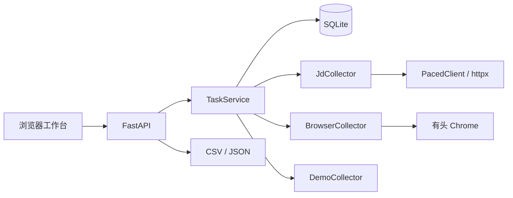
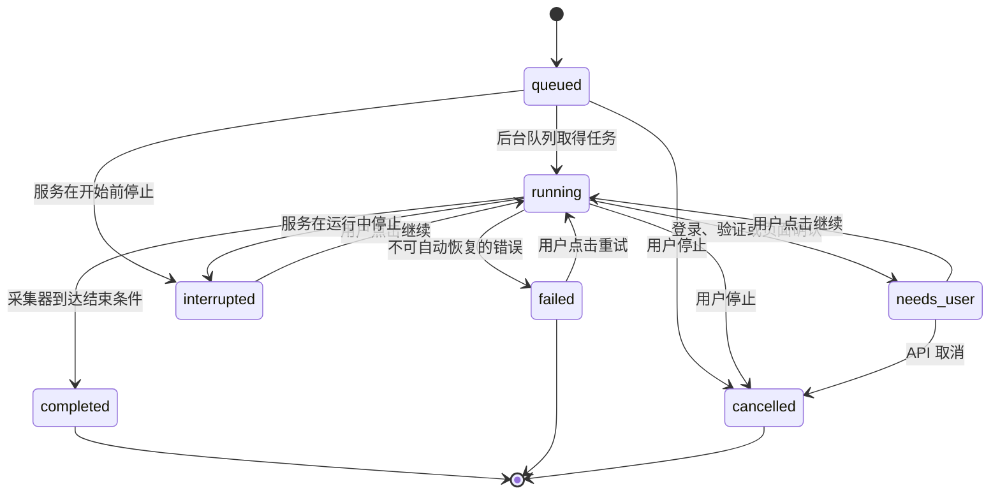

# 评论采样台架构说明

[English](architecture.en.md) · [使用指南](../product/user-guide.zh-CN.md) · [平台限制](../platform-policy.md)

本文说明 0.1.0 的实现。它描述仓库里现有的代码和边界，不把计划中的功能写成已经可用。

## 1. 部署形态

应用是一个在本机运行的单进程 Python 服务：

- FastAPI 提供 API 和静态页面。
- Uvicorn 固定监听 `127.0.0.1:8765`，只接受本机连接。
- SQLite 保存任务和评论，默认路径是 `runtime/review-sampler.sqlite3`。
- 采集任务由应用内线程执行，没有 Redis、消息队列或独立 worker。
- 浏览器协助使用 Playwright 和持久化 Chrome 配置目录。

默认数据路径相对于启动命令的工作目录。数据库路径可以通过 `REVIEW_SAMPLER_DB` 修改，浏览器状态目录目前固定为 `runtime/browser-state/`。



服务启动入口是 [`review_sampler.main:run`](../../src/review_sampler/main.py)。根目录的 [`main.py`](../../main.py) 仅用于兼容原来从仓库根目录执行脚本的方式。

## 2. 代码分层

| 层 | 位置 | 职责 |
| --- | --- | --- |
| 页面与前端逻辑 | [`static/`](../../src/review_sampler/static/) | 创建任务、轮询状态、筛选评论、触发下载 |
| HTTP API | [`app.py`](../../src/review_sampler/app.py) | 参数校验、任务路由、评论查询和导出 |
| 任务服务 | [`service.py`](../../src/review_sampler/service.py) | 状态变更、线程调度、暂停/继续、错误映射 |
| 存储 | [`store.py`](../../src/review_sampler/store.py) | SQLite 表、事务、去重、筛选、重启恢复 |
| 采集器 | [`collectors/`](../../src/review_sampler/collectors/) | 京东 HTTP、浏览器协助和演示数据 |
| 输入解析 | [`platforms.py`](../../src/review_sampler/platforms.py) | 平台、商品 ID、链接和来源地址 |
| 数据标准化 | [`normalize.py`](../../src/review_sampler/normalize.py) | JSON 字段别名、评分、DOM、验证页识别 |
| 网络访问 | [`net.py`](../../src/review_sampler/net.py) | 节奏控制、超时、有限重试和错误分类 |

采集器只处理平台访问和响应转换。任务状态、数据库写入和导出留在服务层，因此新增适配器时不需要改任务表结构。

## 3. 启动与请求流程

`build_default_app()` 创建 `Store`、`TaskService` 和三个采集器，然后把它们交给 `create_app()`。应用启动时执行 `Store.recover_interrupted()`，把遗留的 `queued`、`running` 任务改为 `interrupted`。

一次创建任务的过程如下：

1. 前端提交平台、商品输入、上限、评论方向和浏览器同意状态。
2. API 解析商品链接或裸 ID，并检查平台是否匹配。
3. 非京东平台必须得到浏览器同意；京东的浏览器兜底也只有在勾选同意后才可用。
4. `Store.create_task()` 写入 `queued` 任务。
5. `TaskService.submit()` 创建后台线程。
6. 执行线程把任务改为 `running`，调用对应采集器。
7. 采集器调用 `runtime.emit()` 保存本批评论并更新游标。
8. 采集器返回后，任务改为 `completed`；需要人工处理或出错时改为相应状态。

HTTP 创建任务返回 `202`。前端随后轮询任务和评论，不在一次请求里等待整个采集过程结束。

## 4. 任务状态机

状态集合固定在 [`store.py`](../../src/review_sampler/store.py)：

```text
queued, running, needs_user, interrupted, completed, failed, cancelled
```



`needs_user` 和 `failed` 不是同一个结果：

- `needs_user` 通常保留正在运行的浏览器采集线程。用户处理页面后，`continue` 会唤醒这个线程。
- `failed` 没有活动线程。用户重试时，服务重新创建执行线程，采集器从任务游标开始。
- `interrupted` 由启动恢复产生。用户继续时也会创建新的执行线程。
- `completed` 只表示采集器执行到当前通道的结束规则，不能证明平台没有更多评论。

`TaskService._active` 记录当前执行中的任务，配合锁避免同一任务启动两个线程。重复点击“继续”不会产生第二个执行器。

## 5. 数据模型

SQLite 使用 WAL、外键和 5 秒 busy timeout。所有连接操作都经过 `Store` 内的 `RLock`。

### `tasks`

任务表保存平台、商品 ID、原始 URL、执行模式、评论方向、浏览器同意状态、上限、状态、原因、已保存数量、游标和尝试次数。`cursor` 只供服务端使用，公开任务接口会移除这个字段。

### `reviews`

评论表保存统一字段：

- 平台和商品 ID。
- 平台评论 ID。
- 内容指纹。
- 作者、标题、正文。
- 1 到 5 星评分、原始时间、可解析时间。
- 规格、购买标记、有用数、来源 URL。
- 首次和最近观察时间。

`platform_review_id` 在 `(platform, product_id, platform_review_id)` 上唯一；内容指纹在 `(platform, product_id, fingerprint)` 上唯一。

### `task_reviews`

同一件商品的评论可以在多个任务中复用。`reviews.task_id` 记录首次写入该评论的任务，`task_reviews` 记录完整的任务与评论关联。因此重复创建任务时，已有评论会链接到新任务，不会复制完整正文。

`tasks.collected_count` 统计这个任务新增的关联数，不是当前关联总数。界面统计当前任务评论时，通过 `task_reviews` 查询。

### 去重规则

标准化器优先用平台评论 ID 生成身份：

```text
platform + product_id + review_id
```

平台没有评论 ID 时，使用作者、正文、原始时间和评分生成指纹。正文先做 Unicode 输入清理和连续空白折叠。写入时先按平台评论 ID 或指纹查找已有记录；找到后只补充空字段、更新有用数和最近观察时间。

去重以商品为范围。同一指纹可以出现在另一件商品下。记录缺少正文或作者会被跳过，无效负评分也会被丢弃。

保存单条评论和任务关联在同一个事务中。评论写入成功后，`CollectRuntime.emit()` 再提交已保存数量和游标。如果两步之间进程退出，重新采集会再次看到同一批评论，但唯一约束会阻止重复记录。

## 6. 采集器协议

采集器协议定义在 [`collectors/base.py`](../../src/review_sampler/collectors/base.py)：

```python
class Collector(Protocol):
    def collect(self, task: dict, runtime) -> None: ...
```

`CollectRuntime` 提供三个操作：

| 操作 | 行为 |
| --- | --- |
| `checkpoint()` | 检查用户是否停止任务，停止时抛出 `TaskCancelled` |
| `emit(reviews, cursor)` | 按任务上限截取评论、去重写入、更新计数和游标 |
| `pause(kind, message)` | 把任务改为 `needs_user`，阻塞当前采集线程，等待继续或取消 |

采集器不能直接写数据库。它只返回标准化后的 `ReviewDraft`，由运行时处理事务和任务计数。

### 采集器选择

`TaskService._collector_for()` 按以下顺序选择：

1. `mode=browser` 时使用 `BrowserCollector`。
2. 京东 `mode=auto` 时使用 `JdCollector`。
3. 其他平台先找同名采集器，找不到时使用 `BrowserCollector`。

当前注册表只有 `demo`、`jd` 和 `browser`。淘宝/天猫和拼多多没有内置授权 API 适配器，Amazon 没有构建 Creators API 商品元数据通道。

京东公开请求遇到登录、拒绝访问或限流时，如果任务创建时已勾选浏览器同意，服务会改调 `BrowserCollector`。未勾选时，访问失败会保留为 `needs_user` 或 `failed`，不会后台偷偷打开 Chrome。

## 7. 并发与执行边界

应用默认只有一条 Uvicorn 进程。FastAPI 的同步路由由线程池处理，采集任务各有一个守护线程。

有三层隔离：

- `TaskService._active`：同一任务只有一个执行器。
- `Store._lock`：SQLite 调用在进程内串行化。
- `PacedClient._pace_lock`：同一个京东客户端实例的请求共用一个最小间隔。

多个任务可以同时处于 `running`，但浏览器协助任务共用“平台一个配置目录”的约定。同一平台同时打开两个持久化浏览器上下文会争用同一个 Chrome profile，因此同平台浏览器任务应逐项执行。

服务没有跨进程锁。不要对同一个 SQLite 文件和浏览器状态目录同时启动多个应用实例。

## 8. 网络访问、限速与重试

京东 HTTP 通道使用 [`PacedClient`](../../src/review_sampler/net.py)：

- 请求间隔至少 0.8 秒。
- HTTP 超时为 30 秒。
- 请求使用明确的 `ReviewSampler/0.1` User-Agent。
- 429 和 5xx 最多重试 3 次，也就是初次请求加 3 次重试。
- 网络请求异常也使用同一重试上限。
- 遇到 `Retry-After` 时优先使用平台给出的秒数或 HTTP 日期。
- 没有 `Retry-After` 时使用 1、2、4 秒的指数退避，再叠加最多 0.25 秒抖动，单次退避上限为 16 秒。
- 401 和 403 映射为 `AccessDenied`，不自动重试。
- 429 重试耗尽后抛出 `RateLimited`。
- 其他非 2xx、5xx 重试耗尽和连接失败映射为 `NetworkError`。

这套策略只降低正常请求对平台的冲击。它不是绕过风控的机制，也不会切换代理或修改浏览器指纹。

## 9. 京东采集

[`JdCollector`](../../src/review_sampler/collectors/jd.py) 请求 `club.jd.com` 的公开评论页面，解析 JSONP，并把 `all`、`negative`、`positive` 映射为京东的方向参数。

每页最多请求 10 条。采集器按任务上限截断，记录当前页码游标，并处理三种结束条件：

- 到达任务上限。
- 页面返回空评论列表。
- 到达响应中的 `maxPage`，或连续看到相同响应。

如果响应明显是风控页面，采集器抛出验证错误；如果包含“活动太火爆”等提示，则归类为限流。公开页面不是稳定开发者契约，字段、页面和错误形式都可能变化。

## 10. 浏览器协助

[`BrowserCollector`](../../src/review_sampler/collectors/browser.py) 使用 Playwright 的 `launch_persistent_context()`：

- 使用有头 Chrome，配置目录为 `runtime/browser-state/<platform>/`。
- 不读取用户日常 Chrome 的 profile。
- 首次访问某平台时暂停在 `needs_user`，由用户自行登录或处理页面要求。
- 页面加载后监听 JSON 响应，并读取当前页面。
- 每轮向下滚动 1800 像素并等待约 1 秒。
- 最多执行 8 轮；连续两轮没有新增评论时提前结束。
- 页面跳转后的 URL 写入任务游标。

JSON 响应由通用字段别名提取。DOM 解析目前只实现京东和 Amazon；淘宝和拼多多依赖页面已经加载的 JSON 数据。

验证识别查看 URL、页面标题和正文中的固定标记。命中时再次进入 `needs_user`。工具不会自动填写登录、点击验证码、拖动滑块或上演真人行为。页面仍无可见评论时，任务以解析错误结束，已有数据保留。

浏览器状态目录可能包含身份 Cookie。它位于 `.gitignore` 覆盖的 `runtime/` 下，没有加密。服务停止前不要复制或删除正在使用的 profile。

## 11. API 与前端

主要路由：

| 方法 | 路径 | 用途 |
| --- | --- | --- |
| `GET` | `/api/platforms` | 平台能力和本机 Chrome 检测 |
| `POST` | `/api/tasks` | 创建真实平台任务 |
| `POST` | `/api/demo` | 创建 1 到 24 条演示评论 |
| `GET` | `/api/tasks` | 最近任务列表 |
| `GET` | `/api/tasks/{id}` | 单个任务状态 |
| `POST` | `/api/tasks/{id}/continue` | 继续、恢复或重试 |
| `POST` | `/api/tasks/{id}/cancel` | 停止并保留数据 |
| `GET` | `/api/reviews` | 按任务、关键词、评分和购买标记查询 |
| `GET` | `/api/tasks/{id}/export.csv` | 导出当前筛选 |
| `GET` | `/api/tasks/{id}/export.json` | 导出当前筛选 |

前端每 1.5 秒轮询活动任务，页面隐藏时暂停立即刷新。评论每页加载 100 条。任务、筛选和导出流程都在同一个页面完成。

评论正文通过 `textContent` 写入 DOM。评论中的 HTML 和脚本不会变成可执行页面元素。样式和脚本位于 `static/`，页面没有内联事件处理器。

## 12. 导出与本地安全

CSV 和 JSON 导出都使用当前任务的关键词、评分和购买标记筛选。导出接口一次最多读取 5000 条，和任务上限一致。

CSV 使用 UTF-8 BOM。所有文本单元格会删除 NUL；以 `=`, `+`, `-`, `@` 开头的字符串会加一个单引号，避免电子表格执行公式。JSON 保留原始字符串，不添加这层保护。

服务没有：

- 用户登录或多租户隔离。
- HTTPS、访问令牌或 CORS 配置。
- 数据库加密。
- 浏览器 Cookie 加密。
- 云端同步。

这些限制与“只监听本机回环地址”配套。不要把服务端口暴露到局域网或公网。导出文件可能包含昵称、购买标记和评论正文，分享前需要检查。

## 13. 增加一个平台

新增平台时按现有边界修改：

1. 在 [`platforms.py`](../../src/review_sampler/platforms.py) 扩展平台名、受支持主机、商品 ID 规则和来源 URL。
2. 为新平台补充链接解析、短链接拒绝和错误文案。
3. 实现一个满足 `Collector` 协议的采集器，把平台响应转换为 `ReviewDraft`。
4. 在 [`main.py`](../../src/review_sampler/main.py) 的采集器注册表中登记平台。
5. 如果页面 JSON 的字段不同，先扩展 [`normalize.py`](../../src/review_sampler/normalize.py) 的受控别名；不要在一个平台里复制整套标准化逻辑。
6. 如果确实有官方授权 API，保留凭证从环境变量或本机忽略配置读取，并让缺少凭证的任务停在 `needs_user(authorization)`。
7. 添加固定响应或页面夹具，覆盖输入解析、成功采集、空结果、限流、登录、验证和解析失败。
8. 更新使用指南、本架构说明和[平台访问与使用边界](../platform-policy.md)。

任务表和 `ReviewDraft` 已经覆盖当前标准字段。只有新增业务字段确实需要保存时才修改数据模型。

## 14. 测试入口

测试使用固定响应、HTML 夹具和临时 SQLite 数据库，不访问真实平台：

- [`tests/test_platforms.py`](../../tests/test_platforms.py)：商品 ID、URL、短链接和平台能力。
- [`tests/test_normalize.py`](../../tests/test_normalize.py)：多平台 JSON、评分、去重指纹、DOM 和验证页识别。
- [`tests/test_store.py`](../../tests/test_store.py)：去重、筛选、关联和重启恢复。
- [`tests/test_service.py`](../../tests/test_service.py)：任务状态、取消、暂停、重试和京东浏览器兜底。
- [`tests/test_net.py`](../../tests/test_net.py)：限速、`Retry-After`、退避和错误分类。
- [`tests/test_jd.py`](../../tests/test_jd.py)：京东分页、方向参数和异常响应。
- [`tests/test_api.py`](../../tests/test_api.py)：任务 API、筛选和导出。
- [`tests/test_browser.py`](../../tests/test_browser.py)：浏览器批次、上限和 Playwright 缺失。
- [`tests/test_frontend.py`](../../tests/test_frontend.py)：页面控件、静态资源和安全 DOM 用法。

运行：

```bash
.venv/bin/pytest -q
node --check src/review_sampler/static/app.js
```

## 15. 已知限制

- 淘宝、拼多多和 Amazon 的真实线上评论采集没有纳入默认自动化验证。
- 淘宝和拼多多没有内置授权 API 适配器。
- Amazon Creators API 不提供评论列表。
- CSV 和 JSON 导入未实现。
- 没有日期筛选、跨平台商品匹配、图片下载或评论情感分类。
- 浏览器仅执行有限滚动，无法自动展开“更多评论”等交互控件。
- 同一平台浏览器任务应串行运行。
- 页面改版、账号权限、地区、登录状态和平台条款都会改变可用结果。
