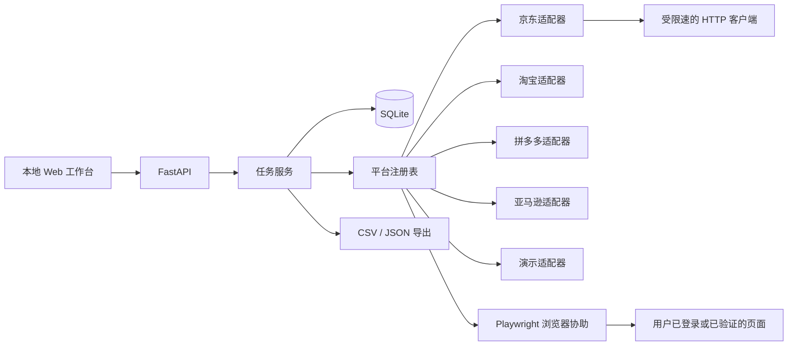

# 跨平台商品评论工作台设计

状态：待确认  
日期：2026-11-02

## 1. 为什么做

原仓库是一个约 60 行的京东评论脚本。它把商品 ID、京东评论接口、字段名、分页和 CSV 输出都写死在 `main.py` 中，目标只是导出 HP 打印机评论。脚本没有平台抽象，也无法说明什么时候抓完了、什么时候被拦截了、为什么只拿到一部分。

新的使用场景是：个人或小团队输入一个商品 ID 或商品链接，在淘宝/天猫、京东、拼多多和亚马逊之间选择平台，创建可恢复的采集任务，查看进度和异常，最后筛选并导出统一格式的评论。

用户已经选择“官方 API 优先 + 用户浏览器会话兜底”，用途是个人或团队的商品评论分析。

## 2. 产品判断

这个工具的价值不在于“能绕过几个网站”，而在于把四类容易丢数据的流程收拢起来：

- 商品输入和平台识别。
- 可解释的任务状态。
- 评论字段标准化和去重。
- 中断后的续采与导出。

平台许可和数据开放程度不在本工具控制范围内。产品应该把能力边界直接展示给用户，不能用“支持四个平台”掩盖某个平台只能导入或只能人工查看。

## 3. 目标

### 用户目标

- 输入商品链接或 ID，自动识别支持的商品标识；识别失败时可以手动指定平台。
- 一次查看所有平台的任务，知道当前在等待、读取、已完成还是被平台拦截。
- 遇到登录或验证时，在有头浏览器里自行处理，然后继续同一个任务。
- 每个任务都能增量更新，重复抓到的评论不重复保存。
- 按平台、评分、关键词、日期和已验证购买筛选，导出 CSV 或 JSON。
- 没有可用账号或网络时，仍能通过演示数据了解完整流程。

### 工程目标

- 一条命令启动本地 Web 工作台。
- 只依赖 SQLite，不要求 Redis、消息队列或外部数据库。
- 采集逻辑与 HTTP API、任务存储和界面分离，新增平台不需要改任务模型。
- 评论先落库再推进游标，失败时保留已取得的数据。
- 凭证只从环境变量或本机忽略文件读取；日志、数据库和导出包都不保存原始秘密。
- 首版提供自动化测试，覆盖输入解析、去重、续采、错误状态和导出。

## 4. 非目标

- 不提供代理轮换、浏览器指纹伪装、自动打码或模拟真人。
- 不绕过登录、验证码、访问限制或平台授权。
- 不保证任意商品都能取得全部历史评论。
- 不做多租户、计费、团队权限、云端 Cookie 池或公开数据市场。
- 不抓取评论中的图片、用户主页或其他非评论字段。
- 不承诺平台字段长期稳定；适配器需要版本和明确故障信息。

## 5. 失败条件

以下情况应按产品失败处理，即使程序返回了 HTTP 200：

- 遇到风险验证却继续发送页面数据请求。
- 把“无权限”“页面改版”“被限流”保存成成功的空任务。
- 同一条评论因重复采集出现多次。
- 任务重启后重复抓取大量页面，或丢失已经保存的结果。
- 日志、数据库快照或导出文件泄露 Cookie、令牌和账号信息。
- 界面宣称某平台“已支持自动采集”，但实际只有演示数据或手工导入。

## 6. 方案取舍

### 方案 A：本机混合工作台（采用）

FastAPI 提供本地 API 和页面，SQLite 保存任务与评论，Playwright 在缺少正式接口时打开有头浏览器。用户完成登录或验证后点击继续；程序读取页面已经加载的评论数据和可解析的页面内容。

优点：

- 登录状态留在用户自己的机器和浏览器会话里。
- 部署面小，个人分析不需要服务器和账号体系。
- 能统一任务、去重、续采和导出，同时按平台显示不同能力。
- 验证失败可暂停，不需要用隐蔽手段维持后台抓取。

代价：

- 不能无人值守覆盖所有平台。
- 页面改版会影响浏览器适配器。
- 用户必须理解“平台授权和账号可见范围”决定能取到哪些数据。

### 方案 B：云端多租户采集服务

集中调度浏览器任务，用户把平台授权或登录状态交给服务。

它能扩展到多人并发，但需要处理凭据托管、会话隔离、审计、封禁申诉、数据删除和更高的安全成本。个人分析场景没有足够收益，首版不采用。

### 方案 C：只做评论导入和分析

用户从各平台导出文件，系统统一清洗、筛选和出图。

它最稳定，也几乎没有平台风险，但没有满足“输入商品 ID 后发起采集”的核心需求。可以保留导入能力，作为无授权时的兜底，但不能代替主流程。

## 7. 能力分级

界面对每个平台显示“自动接口”“浏览器协助”“仅导入”三种能力之一。能力是运行时结果，不写死为营销文案。

| 平台 | 首版输入 | 首选通道 | 兜底通道 | 产品限制 |
| --- | --- | --- | --- | --- |
| 京东 | 数字 ID、商品 URL | 公开评论接口 | 有头浏览器协助 | 接口变化或限流时明确报错 |
| 淘宝/天猫 | `itemId`、商品 URL | 已配置的授权接口 | 仅在用户启用并确认授权后打开页面协助 | 未取得平台许可时不自动采集 |
| 拼多多 | 商品 ID、商品 URL | 已配置的授权接口 | 仅在用户确认授权后打开页面协助 | 不内置绕过平台限制的通道 |
| 亚马逊 | ASIN、商品 URL | 平台可用导出/授权数据 | 有头浏览器协助 | Creators API 不提供评论列表；失败原因要准确说明 |

首版实现中，平台适配器都必须能完成输入解析、任务创建、结果标准化和状态解释。浏览器采集能否成功取决于用户会话、页面实际加载情况和平台规则，不作为无条件验收项。

首版的验收范围定为：

- 四个平台都能从链接或裸 ID 创建任务，并显示真实能力与限制。
- 演示数据、字段标准化、去重、续采、筛选和导出在无平台凭证时可用。
- 京东读取链路通过固定响应夹具测试；能访问真实页面时再做一次带限速的手工冒烟检查。
- 淘宝/天猫、拼多多、亚马逊提供浏览器协助流程和解析夹具，不承诺在默认测试环境中取得线上评论。
- 没有授权的平台不会伪造成功结果。页面结构或账号权限不支持时，任务返回可处置的状态。

站点范围为中国大陆的京东、淘宝/天猫和拼多多，以及用户粘贴的商品 URL 所属的 Amazon 公开区域站点。Amazon 输入以 ASIN 为准，任务保留原始域名用于浏览器跳转；默认测试只用 `amazon.com` 夹具。

## 8. 关键体验

### 新建任务

主页面顶部只有一个主要动作：“采集评论”。表单包含商品链接或 ID、平台、采集上限、内容模式和可选的授权说明确认。粘贴完整链接时自动识别平台和 ID；只输入 ID 时必须选择平台。

“允许浏览器协助”默认关闭。打开后出现一句短说明：工具会打开本机浏览器，登录和验证由用户完成，程序不会保存密码、截图或验证码内容。

### 任务状态

状态固定为：

- `queued`：已创建，等待执行。
- `running`：正在请求或读取页面。
- `needs_user`：需要登录、验证、页面确认或授权，任务暂停。
- `interrupted`：本地服务在任务运行期间停止，需要用户恢复。
- `completed`：到达用户上限，或确认没有更多可读评论。
- `failed`：权限、接口、解析或网络错误，且当前无法自动恢复。
- `cancelled`：用户主动停止。

`needs_user` 不是失败。界面显示原因和“我已完成，继续”按钮。用户继续后，任务从已保存游标开始。

### 结果工作台

结果按时间或首次采集顺序展示。顶部显示各平台数量、评分分布和筛选条件；主体保持更像一份检查记录，而不是十二张相同卡片。桌面端采用左侧任务轨道、右侧宽内容区，移动端纵向排列。

操作包括：

- 按平台、评分、日期、关键词和已验证购买筛选。
- 查看评论原始时间和标准化时间。
- 打开来源页面。
- 导出当前筛选结果为 CSV 或 JSON。
- 对失败任务重试，或继续未完成任务。

### 错误文案

错误说明必须回答三件事：发生了什么、数据是否已保存、下一步能做什么。

例子：

> 京东在读取第 3 页时返回了验证页面。前 2 页的 47 条评论已经保存。请打开浏览器完成页面提示，然后回到这里继续。

不显示“抓取失败，请重试”这种没有处置信息的文案。

## 9. 系统结构



采用单体进程，后台任务由应用内线程执行。任务表是唯一状态源，进程重启后运行中的任务改为 `interrupted`，由用户手动继续。首版不引入常驻 worker 或消息队列。

SQLite 开启 WAL，数据库和本地会话目录放在应用数据目录并加入 `.gitignore`。单条评论使用事务写入，任务游标和进度只在数据成功落库后更新。

## 10. 数据模型

### `tasks`

- `id`：UUID 字符串。
- `platform`：`jd`、`taobao`、`pdd`、`amazon` 或 `demo`。
- `product_id`：平台内商品 ID。
- `input_url`：用户原始输入，可空。
- `mode`：`auto`、`browser` 或 `import`。
- `limit`：本次最多读取条数，1–5000。
- `status`：七个固定状态之一。
- `status_reason`：面向用户的下一步说明。
- `collected_count`：当前任务已保存条数。
- `cursor`：适配器可解析的断点 JSON，可为空。
- `attempts`：连续失败次数。
- `created_at`、`updated_at`、`started_at`、`finished_at`。
- `error_code`：稳定的机器可读错误码，可空。

### `reviews`

- `id`：本地自增主键。
- `task_id`、`platform`、`product_id`。
- `platform_review_id`：平台评论 ID，可空。
- `fingerprint`：规范化字段的 SHA-256，必填。
- `author`、`title`、`content`：文本。
- `rating`：1–5 的整数，可空。
- `created_at_text`：原平台时间文本。
- `created_at`：可可靠解析出的 UTC 时间，可空。
- `variant`、`verified_purchase`、`helpful_count`、`source_url`。
- `first_seen_at`、`last_seen_at`。

唯一约束分两层：非空 `platform_review_id` 在 `(platform, product_id, platform_review_id)` 上唯一；其余记录在 `(platform, product_id, fingerprint)` 上唯一。重复观察只更新 `last_seen_at` 和可补全的空字段。

规范化指纹包含作者、标题、正文、评分和原始时间，先做 Unicode 规范化、首尾空白清理和连续空白折叠。它只用于去重，不用于推断评论真伪。

### 任务去重与增量

“全部评论”在页面上本身可能不断变化，因此产品把 `limit` 当作硬上限，把“没有下一页且连续一轮没有新记录”当作自然完成。每次保存 `cursor`，浏览器协助模式记录已见指纹集合的摘要。重复任务默认续接到同一商品的任务集合，不重复生成记录。

## 11. 适配器接口

```python
class Collector(Protocol):
    platform: str
    def capabilities(self) -> dict: ...
    def collect(self, task: Task, context: CollectContext) -> CollectResult: ...
```

`CollectResult` 包含本批标准评论、新游标、已见数量、是否自然结束，以及可选的人工处理请求。人工处理请求只描述 `login`、`verification`、`page_confirmation` 或 `authorization`，不包含 Cookie 或截图。

平台适配器负责：

- 解析和校验商品标识。
- 生成来源 URL。
- 选择可用通道。
- 将平台字段映射为标准评论。
- 识别分页结束和需要人工处理的状态。

任务服务负责限速、错误归类、重试策略、事务、任务状态和导出。适配器不能直接写数据库或修改任务状态。

## 12. 采集通道

### 授权/自动接口

京东先保留原脚本所用的评论读取能力，补上超时、限速、多页终止和字段兼容。正式商家接口通过适配器扩展，不在没有凭证的情况下假装已接通。

淘宝/天猫和拼多多只显示已配置的授权能力。没有凭证时，任务会停止在 `needs_user(authorization)`，并在界面说明需要平台授权。

亚马逊明确说明 Creators API 不含评论资源。若未来接入有评论权限的官方数据源，通过同一适配器接口加入。

### 浏览器协助

用户主动启用后，Playwright 以有头模式打开来源页。程序先进入 `needs_user`，等待用户自行登录或完成页面提示；用户点击继续后：

1. 监听页面网络响应，提取带评论字段的 JSON。
2. 读取当前页中可识别的评论内容，作为 JSON 不完整时的补充。
3. 用适配器别名和结构提示进行标准化。
4. 只执行纵向滚动，每次滚动后等待页面稳定；连续两轮没有新评论就停止。程序不会自动点击登录、验证、购买或用户身份相关控件。
5. 一旦检测到验证页面、登录重定向或平台警告，马上暂停。

浏览器不会尝试修改指纹、注入规避脚本或自动完成验证。会话只存在本机 `runtime/browser-state/`，该目录默认忽略。一次任务结束后保留会话供下次登录，用户可以从设置页清除。

### 导入

无授权时允许导入 CSV 或 JSON。导入预览显示识别到的字段，用户确认后写入同一评论模型。首版只保证本项目导出的 CSV/JSON 可再次导入；平台原生表格用演示文件说明哪些字段可以识别。

## 13. API

- `GET /api/platforms`：平台与当前能力。
- `POST /api/tasks`：创建任务。
- `GET /api/tasks`：任务列表。
- `GET /api/tasks/{id}`：任务详情和下一步说明。
- `POST /api/tasks/{id}/continue`：用户完成登录/验证后继续。
- `POST /api/tasks/{id}/cancel`：取消任务。
- `GET /api/reviews`：按任务、平台、评分、关键词和日期筛选。
- `GET /api/tasks/{id}/export.csv`：导出任务或筛选视图。
- `GET /api/tasks/{id}/export.json`：导出标准 JSON。
- `POST /api/demo`：创建带样例评论的演示任务。

创建和继续接口使用幂等键或当前状态检查，重复点击不会启动两个并发执行器。

## 14. 限速、重试与错误

- 普通请求间隔至少 800 ms；遇到平台响应头时以更严格值优先。
- 429 或明确限流先读取 `Retry-After`，否则用 1、2、4、8、16 秒上限的指数退避加随机抖动。
- 429、5xx 和超时最多重试 3 次；授权失败、验证页面和结构不兼容不自动重试。
- 限速器按平台共享，同一平台的多个任务不能叠加请求速率。
- 错误码固定为 `AUTH_REQUIRED`、`VERIFICATION_REQUIRED`、`ACCESS_DENIED`、`RATE_LIMITED`、`NETWORK_ERROR`、`PARSE_ERROR`、`UNSUPPORTED`、`INTERRUPTED`。
- 日志只记录任务 ID、平台、状态、页码和错误码，不记录请求头、Cookie、评论全文或凭证。

## 15. 前端方向

视觉主题取“跨平台采样台账”：像一份被不同平台盖章的记录，而不是通用 SaaS 仪表盘。冷灰纸面、深墨蓝结构线和钴蓝主操作形成清楚层级，少量琥珀色只用于需要用户处理的验证状态。

字体使用 `Iowan Old Style`/`Songti SC` 作为标题，`Avenir Next`/`PingFang SC` 作为界面正文。标题排版承担产品识别，正文优先可读性。布局采用左侧窄任务轨道和右侧宽记录区，用连续分隔线组织内容；不使用重复圆角卡片网格。

信息结构：

```text
┌────────────────────────────────────────────────────────────┐
│ 采样台  平台能力                          本地 · 会话状态  │
├───────────────┬────────────────────────────────────────────┤
│ 采集表单      │ 当前任务：京东 / 100023…                   │
│ 或任务轨道    │ 状态：等待你完成页面验证                   │
│               │ [我在页面已完成处理，继续]                 │
│               ├────────────────────────────────────────────┤
│               │ 统计带  筛选  导出                         │
│               ├────────────────────────────────────────────┤
│               │ 评论记录，按时间形成连续台账               │
└───────────────┴────────────────────────────────────────────┘
```

必须满足键盘操作、明显焦点、色差不低于 WCAG AA、移动端可用、尊重 `prefers-reduced-motion`。动画只用于任务状态变化，不做整页弹入。

## 16. 安全与隐私

- 默认只绑定 `127.0.0.1`，不接受局域网访问。
- 浏览器会话目录、SQLite 数据库、`.env` 和导出文件均写入 `.gitignore`。
- 表单不回显凭证；服务端日志对敏感字段做删除。
- 导出不包含任务内部游标、会话信息和服务端路径。
- 设置页提供“清除浏览器会话”和“删除全部本地数据”两个独立动作。
- 评论内容按纯文本渲染，避免把商品评论当成 HTML。

## 17. 验证策略

自动化测试覆盖：

- 四个平台商品链接和裸 ID 的识别，包括查询参数、短链接和错误输入。
- 字段别名归一化、评分边界、时间解析和指纹去重。
- 重复任务增量写入、任务重跑和部分失败保留数据。
- 任务状态迁移，重复继续请求不会启动两个执行器。
- 429/`Retry-After`、指数退避和不可重试错误。
- CSV/JSON 导出中文、引号、换行和筛选结果。
- 浏览器收集器的纯解析逻辑用固定 JSON/DOM fixture 测试；真实站点登录和验证测试不进入默认测试集。

界面验收：

- 桌面 1440×900 和移动 390×844 都能创建任务、查看等待验证、筛选和导出。
- 使用键盘完成主流程。
- 页面没有控制台错误。
- 演示模式可在无网络、无平台凭证时跑完创建、查看、筛选和导出。

## 18. 交付拆分

每个里程碑独立提交并推送：

1. 设计、调研与安全边界。
2. 数据模型、任务 API、统一评论和测试。
3. 适配器、限速、浏览器协助和演示通路。
4. 前端工作台和可访问性检查。
5. 中英文产品使用文档、架构文档与最终验证。

## 19. 留给实现阶段的决定

- 优先实现一条足够稳定的京东读取链路，淘宝、拼多多、亚马逊先完成输入和浏览器协助能力，不伪造未授权接口。
- 浏览器解析先支持 JSON 与平台 DOM fixture，真实页面结构变化时通过适配器版本修复。
- 是否把导入能力放进首个发布取决于它是否挤占核心采集与续采工作；设计保留接口，不将其作为演示通路。
